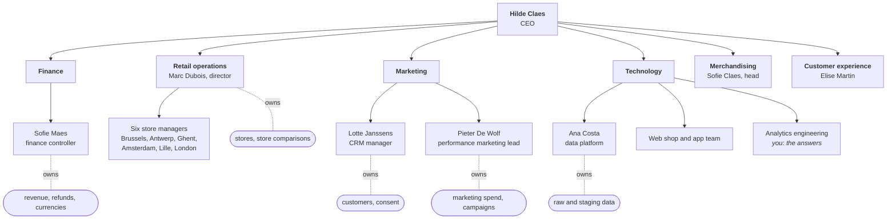

# Stakeholder interviews

Last week you interviewed five people at Fernhill Outfitters. The recording of those interviews is
handed out at the kick-off: a five-minute video. The slides in it show the headlines below; what
people say in between is where the detail is. None of it is written down anywhere in the data: the
data shows *what* happened, not how Fernhill counts it.

Your agents don't watch videos. If you want your factory to know what was said, you have to put it
there yourself (instructions, a skill, a semantic model, a tool). Everything holds for every request,
not only for one.

## Who is who

When two people define a term differently, the owner of the term decides.

## The headlines

| Who | On the slide |
|---|---|
| Sofie Maes, finance controller | Revenue is what has left the building · Everything we report is in euro · Revenue is mine to define |
| Lotte Janssens, CRM manager | Our testers are not customers · A customer starts with a real first order · One account is one customer |
| Marc Dubois, retail operations director | My managers trust the till report · Compare the stores fairly |
| Pieter De Wolf, performance marketing lead | Does social pay off? · Spend is in euro already |
| Ana Costa, data platform | Orders land append-only · Not every table is still filled |
